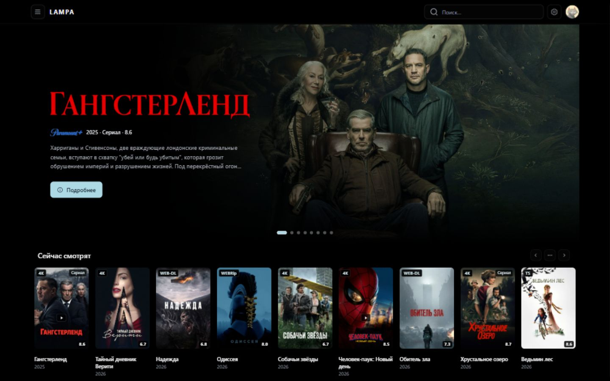
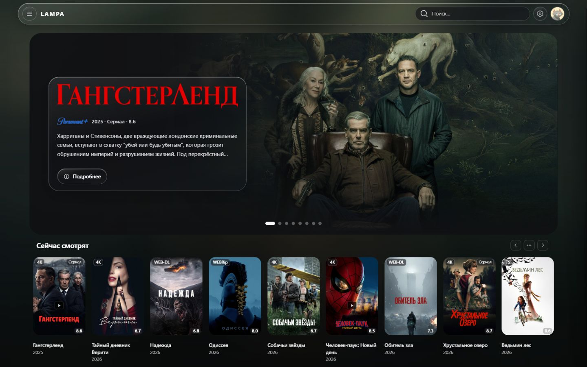
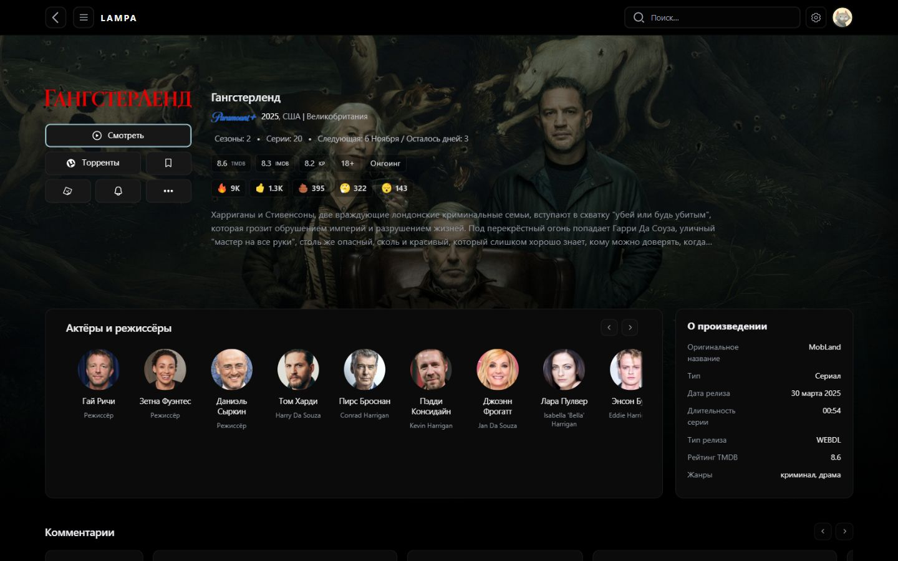
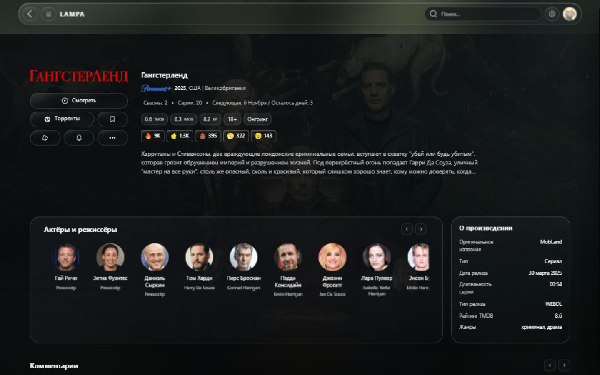
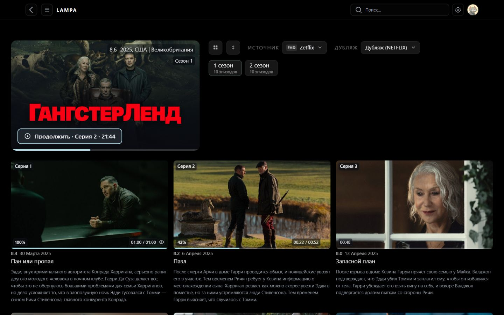
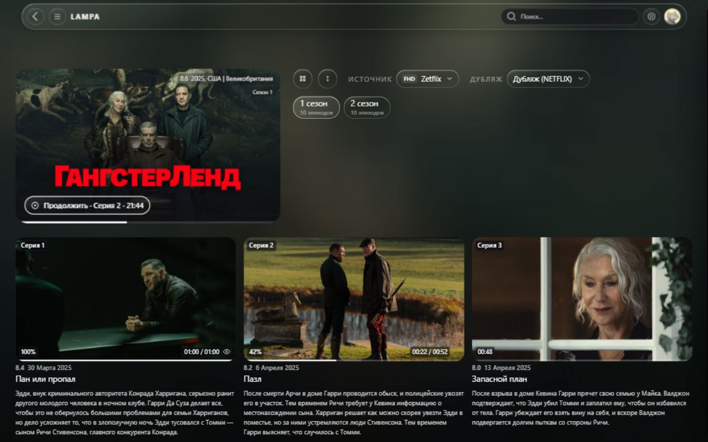
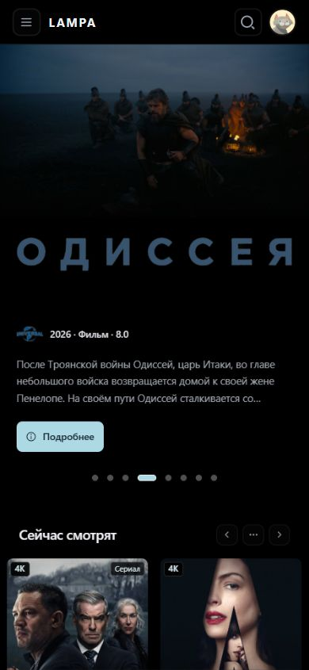
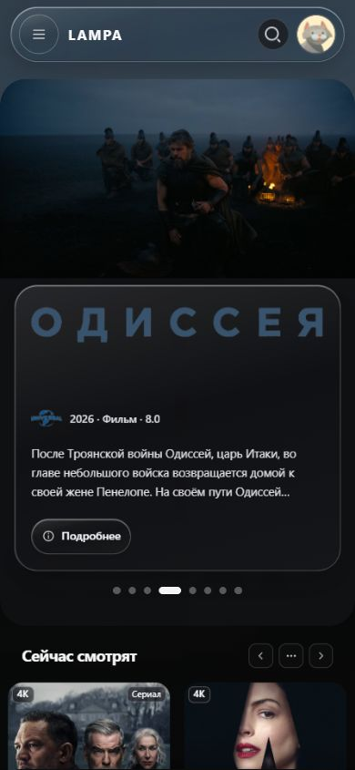
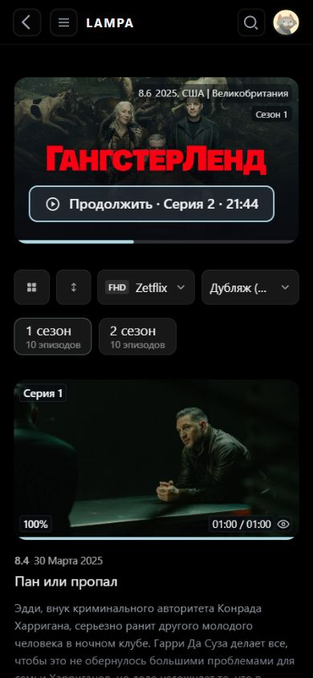
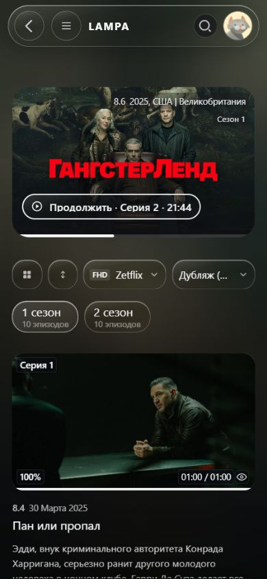

# Lampa View

Оформление Lampa с крупными баннерами, удобными карточками.

Каталог **Trakt** доступен рядом с CUB и TMDB после настройки собственного Client ID. Инструкция: [подключение Trakt](docs/TRAKT.md). Постоянная ссылка на расширение не меняется: [lampa.js](https://notme-si.github.io/lampa-view/lampa.js).

В онлайне правый клик или удержание **OK** на файле открывает действия с просмотренным и таймкодами. Для основной кнопки просмотра они доступны через её меню → **Просмотр и таймкод**. Изменения применяются к текущему файлу или открытому списку через штатные функции провайдера; для них не требуется загрузка ссылки на видео.

Штатная настройка **Настройки → Интерфейс → Размер интерфейса** масштабирует значки, обложки, меню и онлайн-серии. Праздничное оформление использует собственные лаконичные значки рядом с надписью L A M P A; даты праздников и действия кнопок определяет сама Lampa.

## Скриншоты

Версия **0.5.0**. Основные снимки — браузерный интерфейс при ширине 1440 пикселей. Тема выбирается в **Настройки → L A M P A → Оформление → Тема интерфейса**.

<table>
  <tr><th>Оригинал</th><th>Стекло</th></tr>
  <tr><td><a href="docs/screenshots/original-home.jpg"></a><br>Главная</td><td><a href="docs/screenshots/glass-home.jpg"></a><br>Главная</td></tr>
  <tr><td><a href="docs/screenshots/original-detail.jpg"></a><br>Карточка сериала</td><td><a href="docs/screenshots/glass-detail.jpg"></a><br>Карточка сериала</td></tr>
  <tr><td><a href="docs/screenshots/original-online.jpg"></a><br>Онлайн: серии и описания</td><td><a href="docs/screenshots/glass-online.jpg"></a><br>Онлайн: серии и описания</td></tr>
</table>

### Дополнительно: телефонный вид

Адаптивный интерфейс в браузере при ширине 390 пикселей. Это не фотографии физического iPhone или Android APK; системные панели зависят от устройства и приложения.

<table>
  <tr><th>Оригинал</th><th>Стекло</th></tr>
  <tr><td><a href="docs/screenshots/original-mobile-home.jpg"></a><br>Главная</td><td><a href="docs/screenshots/glass-mobile-home.jpg"></a><br>Главная</td></tr>
  <tr><td><a href="docs/screenshots/original-mobile-online.jpg"></a><br>Онлайн</td><td><a href="docs/screenshots/glass-mobile-online.jpg"></a><br>Онлайн</td></tr>
</table>

## Установить плагин

1. В Lampa откройте **Настройки → Расширения → Добавить плагин**.
2. Вставьте адрес и перезапустите Lampa:

```text
https://notme-si.github.io/lampa-view/lampa.js
```

Резерв качества Alloha работает через настроенный сервер онлайн-источников с включённым Alloha. Собственные ключи сторонних сервисов плагин не содержит.

## Установить загрузочный экран

Для своего сервера Lampac на Linux выполните одну команду:

```sh
curl -fsSL https://notme-si.github.io/lampa-view/install.sh | sudo sh
```

Готово. Поддерживается стандартная установка в `/opt/lampac` с systemd. Обновление — той же командой. [Как отключить](server/README.md).

## Плеер

Для Windows доступен [mpv+](https://github.com/Notme-SI/mpv-plus/releases/latest). В Lampa Desktop выберите внешний плеер `mpv.exe` из папки mpv+. Данные карточки передаются автоматически; отдельный мост устанавливать не нужно.

Для установленного тестового **mpv+ iOS 0.2** добавьте в расширения Lampa отдельный плагин:

```text
https://notme-si.github.io/lampa-view/mpvplus-ios.js
```

Он поддерживает Lampa, добавленную на домашний экран iPhone из Safari. Перезапустите Lampa и выберите **mpv+** в настройках плеера — он включится и для торрентов. Для торрентов также доступны пункты **Открыть в mpv+** и **Передать весь список в mpv+** в меню долгого нажатия на файл. Передаются выбранный файл, доступный плейлист, названия, качество и метаданные; переустановка iOS-приложения для этого плагина не нужна.

В мосте **0.2.6** выбранный mpv+ получает ссылки на воспроизведение без ожидания предзагрузки в Lampa. После выбора серии окно файлов закрывается и появляется доступное для нажатия меню **Открыть в mpv+**. Добавлять сервер в раздел «Свой TorrServer» приложения для этого не нужно. Нажмите пункт запуска: переход в приложение требует отдельного нажатия. Если в установленном расширении осталась старая копия, замените его адрес на `https://notme-si.github.io/lampa-view/mpvplus-ios.js?v=0.2.6`. Если недоступен сам сервер или нужна авторизация на поток, воспроизведение не сможет начаться. Раздача с подписью «Серии 1 из 10» может содержать только первую серию; полный список появится у раздачи с несколькими файлами.

Этот мост работает только на **iPhone/iPad**. В Windows используйте штатный пункт **«Внешний»** с путём к `mpv.exe`, на Android TV — **«Android»** с выбором Vimu/Just Player в приложении. Если раньше там был выбран iOS-пункт `mpv+`, смените «Тип плеера для торрентов» вручную. Версия 0.2.6 сохраняет настройки остальных устройств и не перехватывает их воспроизведение.

Сторонние плееры остаются в списках. Если mpv+ уже выбран для онлайна, при первом обновлении моста 0.2.2 он включится и вместо стандартного торрент-плеера; дальнейший ручной выбор сохраняется. Стартовых уведомлений нет. Закладка Safari не требуется. Скрипт передаёт данные локальной URL-схемой `mpvplus://`, не загружая плейлист на внешний сервер. Запуск через штатное окно файлов и длинное нажатие проверяется на нативном коде Lampa; переход в приложение и воспроизведение конкретного потока требуют проверки на устройстве. Код и проверки моста находятся в `plugins/mpvplus-ios.js` и `tests/mpvplus-ios*.test.cjs`; исходников нативного iOS-приложения в этом репозитории нет.

## Источники

- **Закусь TV / Автопилот** — [страница плагина](https://hub.alcopa.cc/hub/u/YXblJI9HT).
- **AGNative**, основа Закусь TV — [Llowmikee](https://github.com/Llowmikee), [appletv_agnative.js](https://llowmikee.github.io/AppleTVAGNativeNG/appletv_agnative.js).
- **Дизайн Potok** — [potok.rip](https://potok.rip/), [potok-media](https://github.com/potok-media).
- **Nova Plus** — [amikdn](https://github.com/amikdn/amikdn.github.io), [nova_plus.js](https://amikdn.github.io/nova_plus.js), [card_overlay.js](https://amikdn.github.io/card_overlay.js).

[Изменения](CHANGELOG.md) · [Разработка](CONTRIBUTING.md) · [Источники и лицензии](THIRD-PARTY.md)
