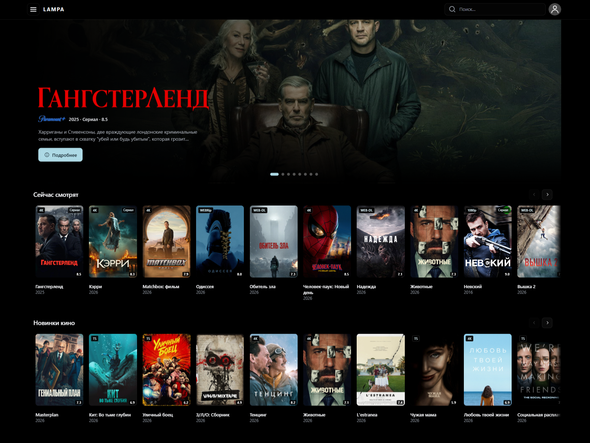
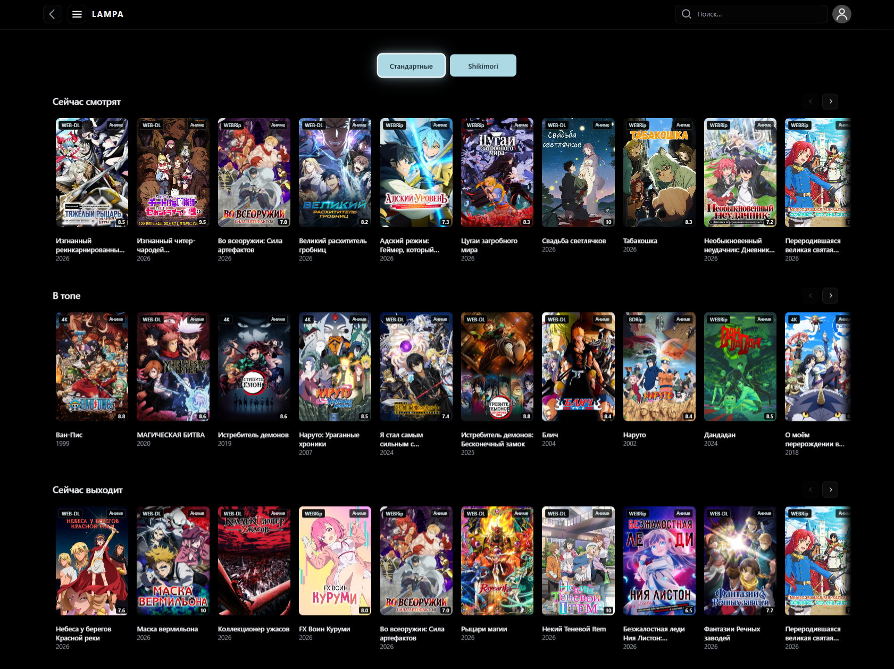
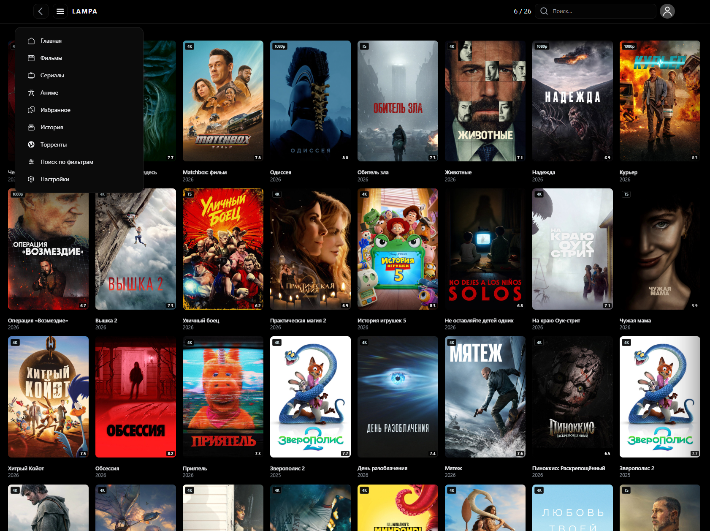
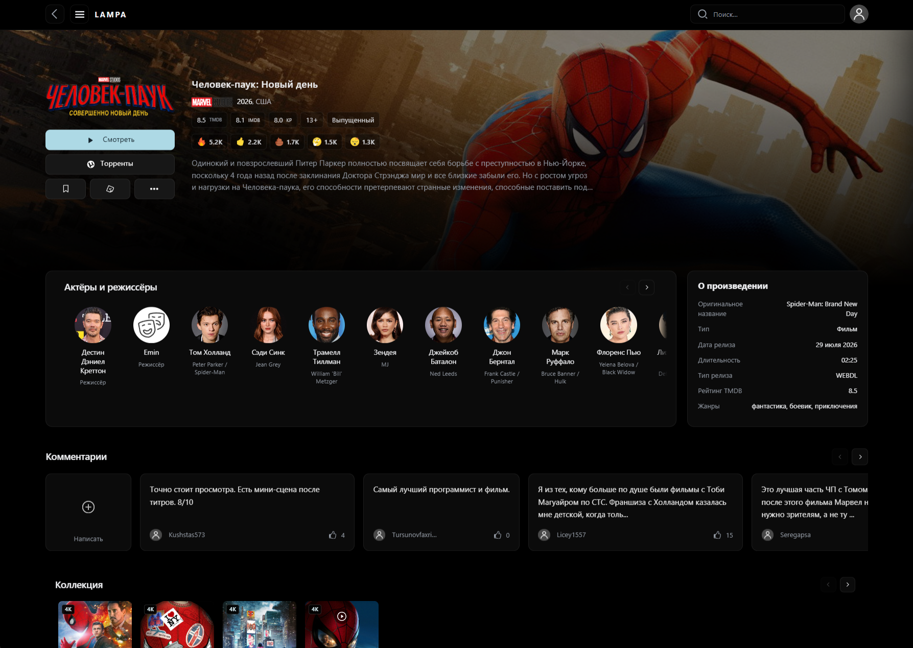
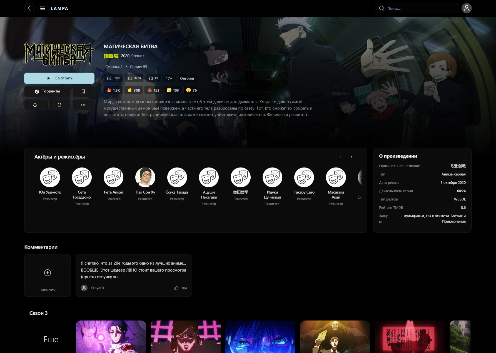

# Lampa View

Оформление Lampa с крупными баннерами, удобными карточками и плавной прокруткой.

## Установить плагин

1. В Lampa откройте **Настройки → Расширения → Добавить плагин**.
2. Вставьте адрес и перезапустите Lampa:

```text
https://notme-si.github.io/lampa-view/lampa.js
```

Если установлен старый адрес этого плагина, замените его новым.

## Установить загрузочный экран

Для своего сервера Lampac на Linux выполните одну команду:

```sh
curl -fsSL https://notme-si.github.io/lampa-view/install.sh | sudo sh
```

Готово. Поддерживается стандартная установка в `/opt/lampac` с systemd. Обновление — той же командой. [Как отключить](server/README.md).

## Плеер

Для Windows доступен [mpv+](https://github.com/Notme-SI/mpv-plus/releases/latest). В Lampa Desktop выберите внешний плеер `mpv.exe` из папки mpv+. Данные карточки передаются автоматически; отдельный мост устанавливать не нужно.

## Скриншоты

<a href="docs/screenshots/01-home.png"></a>

<table>
  <tr>
    <td><a href="docs/screenshots/02-anime.png"></a><br>Аниме</td>
    <td><a href="docs/screenshots/03-catalogue.png"></a><br>Каталог и навигация</td>
  </tr>
  <tr>
    <td><a href="docs/screenshots/04-movie.png"></a><br>Карточка фильма</td>
    <td><a href="docs/screenshots/05-anime-detail.png"></a><br>Карточка аниме</td>
  </tr>
</table>

[Изменения](CHANGELOG.md) · [Разработка](CONTRIBUTING.md) · [Лицензии](THIRD-PARTY.md)
